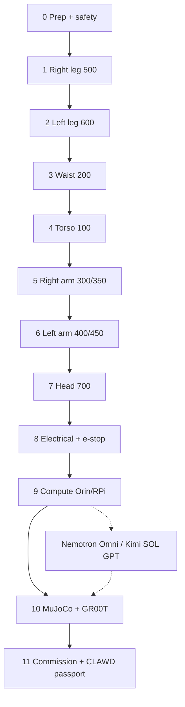

# Asimov v1 · Assembly flow (Solana Robotics Kit)

Stage-by-stage assembly for the kit’s **ASV1** tree under `robotics/mechanical/ASV1/`, MuJoCo sim under `robotics/sim-model/`, and software bring-up (daemon, $CLAWD passport, Nemotron / SOL GPT).

> Official Menlo manual: [docs.menlo.ai/asimov/1](https://docs.menlo.ai/asimov/1) · Design system: [`robotics/DESIGN.md`](../robotics/DESIGN.md)  
> Part IDs: `ASV1_500_02A` = project · subassembly · part · method (A CNC / B SLM / C MJF / X COTS).

```
PREP → R LEG → L LEG → WAIST → TORSO → R ARM → L ARM → HEAD
     → ELECTRICAL → COMPUTE → SIM PARITY → COMMISSION + $CLAWD
```

---

## Stage map

| # | Stage | ASV1 codes | Exit criteria |
|--:|:------|:-----------|:--------------|
| 0 | Preparation & safety | — | Tools, e-stop plan, support fixture, ESD |
| 1 | Right leg | **500** | Free joint range; no cable pinch |
| 2 | Left leg | **600** | Mirrors right; matched zero offsets |
| 3 | Waist / pelvis | **200** | Yaw torque path clear; harness pass-through |
| 4 | Torso | **100** | Battery bay, IMU, speaker mounts |
| 5 | Right arm + hand | **300**, **350** | Gravity-comp smoke; hand free |
| 6 | Left arm + hand | **400**, **450** | Mirrors right |
| 7 | Head | **700** | Camera + mics; neck limits |
| 8 | Electrical & power | — | Bus voltages green; e-stop cuts motors |
| 9 | Compute stack | — | Orin/RPi boots; daemons healthy |
| 10 | Sim bring-up | — | `asimov.xml` loads; joint map matches FW |
| 11 | Commission + passport | — | Supported tests; $CLAWD robot passport |

Programmatic plan (hours + $ allocation):

```python
from asimov import assembly_plan, inventory
print(inventory())
print(assembly_plan(10_000))
```

---

## Stage 0 — Preparation

### Tools
- Metric hex set, torque wrench (Nm scale per BOM fasteners)
- Threadlocker (medium / high as BOM), loctite map from Menlo
- Multimeter, USB serial, logic analyzer optional
- 3D-print bed for PA12 replacements if MJF backlog
- Label printer for ASV1 IDs on bags

### Safety
- Never free-stand untested biped without **support** (OpenCrane / gantry / strap).
- E-stop on motor bus **and** software kill.
- Eye protection for spring/preload work; glove policy for SLM edges.
- Fire plan for Li-ion packs.

### Workspace
- Level table + leg jigs; cable trays; ESD mat for boards.
- Inventory scan:

```bash
python3 -c "from robotics.catalog import scan_catalog; import json; print(json.dumps(scan_catalog().summary(), indent=2))"
```

Current kit snapshot: **132 STEP**, **28** sim meshes, XML present.

---

## Stage 1–2 — Legs (500 / 600)

1. Sort FABRICATION bags: `ALU_7075` (A), `SML_316L` (B), `MJF_PA12` (C), `OFF_THE_SHELF` (X).
2. Build hip → knee → ankle → toe chain per Menlo coplanar actuator layout.
3. Install absolute encoders / magnet rings; record zero positions.
4. Route motor phases + sense lines with strain relief at every pivot.
5. Bench test each joint: continuous rotation direction, soft limits, thermal soak 5 min @ 20% duty.
6. **Checkpoint:** photo + log sheet per joint; part IDs listed.

> Note: CAD density may be higher on **500** than **600** in early kit drops — mirror R→L using naming + MuJoCo symmetry when L STEP is sparse.

---

## Stage 3–4 — Waist + torso (200 / 100)

1. Mate pelvis yaw interface; torque pattern star-order.
2. Verify leg harness exits into torso cavity without chafe.
3. Mount battery tray, BMS, main contactor, IMU (orientation arrow up).
4. Speaker + optional cooling fans; keep mass CG near design CAD.
5. **Checkpoint:** dry-fit arms stubs; no interference at max waist yaw.

---

## Stage 5–6 — Arms + hands (300/350, 400/450)

1. Shoulder → elbow → wrist chain; counterbalance if specified.
2. Hand tendons / gears: cycle open-close 50× cold.
3. Sync firmware joint IDs with MuJoCo names in `asimov.xml`.
4. **Checkpoint:** R/L pose mirror within 2° at mid-range.

---

## Stage 7 — Head (700)

1. Neck yaw/pitch stack; hard stops verified before power.
2. Camera focus + IR if night ops; mic array orientation.
3. USB / CSI cable service loop for full neck travel.

---

## Stage 8 — Electrical

1. Power tree: pack → BMS → contactor → 48 V bus → DC-DC → logic 5/12 V.
2. CAN / RS485 / EtherCAT (as BOM) bus termination.
3. E-stop dual-channel; verify motor disable **without** host software.
4. Grounding scheme; shield drains one-end-only where specified.

---

## Stage 9 — Compute

| Role | Option A (budget) | Option B (kit target) |
|------|-------------------|------------------------|
| Realtime control | RPi 5 / CM5 | Jetson Orin Nano 8GB |
| Policy / vision | Cloud GPU | Orin + TensorRT |
| Reasoning brain | Kimi API / SOL GPT | **Nemotron Omni NVFP4** on Spark/Thor/cloud |
| Chain | Helius RPC | Same + $CLAWD passport |

```bash
# Nemotron env doctor (no weight download)
python3 -m packages.nemotron doctor
# or
python3 -c "from packages.nemotron import doctor; print(doctor().as_dict())"
```

See [NEMOTRON_OMNI.md](./NEMOTRON_OMNI.md) and [ORIN_NANO_SETUP.md](./ORIN_NANO_SETUP.md).

---

## Stage 10 — Sim parity

```bash
# If mujoco installed:
python3 -c "import mujoco; m=mujoco.MjModel.from_xml_path('robotics/sim-model/xmls/asimov.xml'); print(m.nq, m.nu)"
```

1. Joint name table: firmware ↔ XML ↔ policy config.
2. Mesh scale / inertia sanity vs CAD mass properties.
3. Isaac GR00T / embodiment tag `asv1_solana_robotics` when training (see `packages/isaac_gr00t`).

---

## Stage 11 — Commission + $CLAWD

1. Supported stand: slow squats, arm waves, head track.
2. Log thermal + current; update action log credits model if using DePIN.
3. Mint / register robot passport (see `packages/robot-passport`, `docs/ROBOT_PASSPORT_GENERATOR.md`).
4. Optional: token-gate operator console with `$CLAWD`.

Mint: `8cHzQHUS2s2h8TzCmfqPKYiM4dSt4roa3n7MyRLApump`

---

## Flow diagram



---

## Software hooks in this monorepo

| Path | Role |
|------|------|
| `asimov/` | Hub API: `inventory()`, `assembly_plan()`, `doctor()` |
| `robotics/` | STEP + MuJoCo + part numbering |
| `packages/nemotron/` | Model doctor / gated HF load / vLLM command |
| `packages/isaac_gr00t/` | GR00T embodiment discovery |
| `packages/moonshot/` | Kimi trading + vision API |
| `apps/robot-daemon/` | Runtime daemon skeleton |
| `client/public/asimov/` | Browser meshes |
| `docs/PLAN_10K_HARDWARE.md` | Budget plan |

---

## Time estimate

| Path | Hours | Notes |
|------|------:|-------|
| Experienced builder, full kit | 50–100 | Menlo published range |
| Kit $10k partial (legs+torso+compute) | 30–60 | Phase-1 of 10k plan |
| Sim-only bring-up | 4–12 | No metal |

Always re-check torque tables and firmware versions from the latest Menlo release notes before first powered step.
