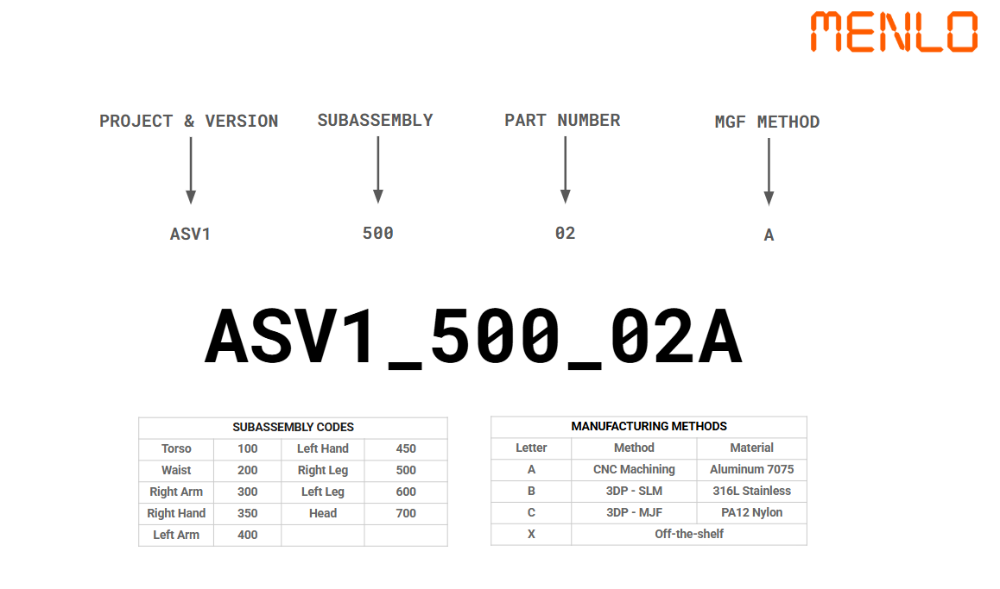

# Mechanical Design — Asimov v1 (ASV1)

CAD for Asimov v1 subassemblies. STEP files for CNC aluminium, SLM stainless, MJF nylon, and off-the-shelf hardware.

## Contents

```
mechanical/
├── README.md                 ← this file
├── naming_convention.png     ← Menlo naming poster
└── ASV1/
    ├── NamingConvention.png
    ├── 100/ … 700/           ← subassembly codes
    │   ├── ASV1_NNN.STEP     ← subassembly assembly
    │   └── FABRICATION/
    │       ├── ALU_7075/     ← method A
    │       ├── SML_316L/     ← method B
    │       ├── MJF_PA12/     ← method C
    │       └── OFF_THE_SHELF/← method X
    └── …
```

**[Browser 3D assembly →](https://static.asimov.inc/asimov/v1/asimov-v1-20260420.html)**

## Naming convention



### Anatomy of a part ID

```
PROJECT & VERSION   SUBASSEMBLY   PART NUMBER   MFG METHOD
        │                │              │            │
      ASV1              500            02           A
        └──────┬─────────┴──────┬───────┴────┬──────┘
               │                │            │
               └────────────────┴────────────┘
                      ASV1_500_02A
```

### Subassembly codes

| Code | Subassembly | Code | Subassembly |
|-----:|:------------|-----:|:------------|
| 100 | Torso | 450 | Left Hand |
| 200 | Waist | 500 | Right Leg |
| 300 | Right Arm | 600 | Left Leg |
| 350 | Right Hand | 700 | Head |
| 400 | Left Arm | | |

### Manufacturing methods

| Letter | Method | Material | Directory |
|:------:|:-------|:---------|:----------|
| **A** | CNC Machining | Aluminum 7075 | `ALU_7075/` |
| **B** | 3DP – SLM | 316L Stainless | `SML_316L/` |
| **C** | 3DP – MJF | PA12 Nylon | `MJF_PA12/` |
| **X** | Off-the-shelf | COTS | `OFF_THE_SHELF/` |

### Python

```python
from robotics import parse_part_id, format_part_id

p = parse_part_id("ASV1_500_02A")
# Right Leg · part 02 · CNC Aluminum 7075
assert format_part_id(500, 2, "A") == "ASV1_500_02A"
```

Inventory:

```bash
python -m robotics.catalog
```

## License

Hardware under [CERN-OHL-S-2.0](../HARDWARE-LICENSE.txt). See package [SOFTWARE-LICENSE.txt](../SOFTWARE-LICENSE.txt) for software tooling.
